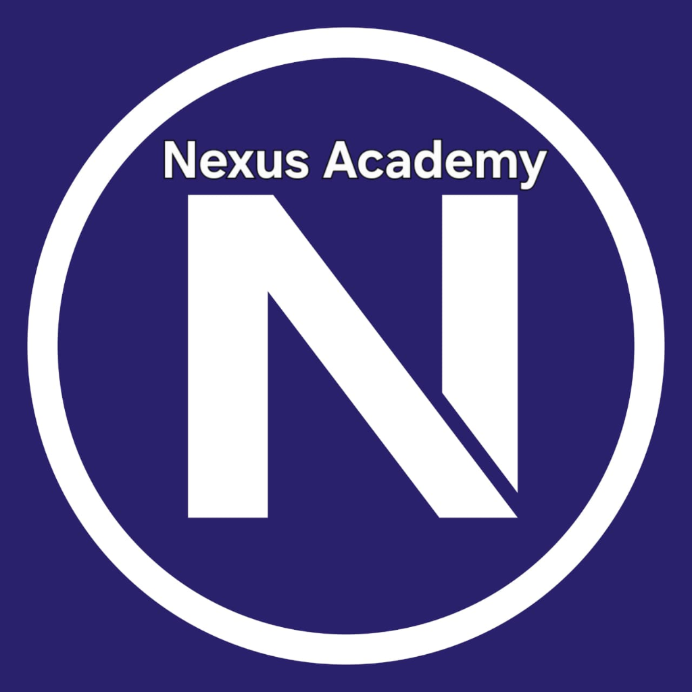

# NexusAcademyLS (Nexus Academy Learning System)

> **Coaching Center Academic & e-Learning Management System**  
> Powered by **Nexus ELMS (Nexus Academy Learning Management System)**.



---

## 🏛️ About Nexus Academy

- **Address:** 965/1, Middle Monipur (Opposite Green Pharma), Mirpur-2, Dhaka-1216  
- **Email:** `nexusacademy.edu.bd@gmail.com`  
- **Phone:** `01633151496`, `01799008544`  
- **Portal URL:** `http://localhost:3000`

---

## 🌟 Key Highlights & Feature Matrix

NexusAcademyLS unifies **UCAM** (Comprehensive Academic Management) and **ELMS** (e-Learning Management System) into a fast, responsive, role-based platform designed specifically for coaching center operations.

| Requirement | Implementation & Architectural Detail |
|---|---|
| **Individual Student Accounts** | Secure bcrypt-hashed password authentication with JWT sessions. Profile badges, enrolled batch, and contact details. |
| **Strict Enrollment Isolation** | **Students are enrolled only in the specific classes they attend.** Non-enrolled classes, exams, and notes are strictly hidden from student access. |
| **Teacher Enrollment Management** | **Enrollment is managed exclusively by the assigned class teacher** (and administrator). Teachers can search student rosters and enroll/unenroll with 1-click. |
| **Teacher Multi-Class Association** | A teacher can be assigned to multiple coaching batches (e.g. Tanvir Ahmed leads both `MTH-201` and `ADM-MTH`). |
| **Exam Results & Grades (UCAM)** | Nexus ELMS Continuous Assessment (Class Tests, Pop Quizzes, Midterms, Finals) with maximum marks, weight %, overall percentage, and section/course rankings. |
| **Soft Copies of Notes (ELMS)** | Course modules with downloadable and viewable lecture notes (PDFs, formula sheets, handouts). Teachers can upload files up to 50MB. |
| **External Links (ELMS)** | Direct categorized links to YouTube video lectures, Google Drive archives, interactive simulations (PhET), and web portals. |
| **Teacher-Only Content Authority** | Role-based middleware ensures **only teachers (and admin) have the authority to add content** (notes, links, exams, announcements). Unauthorized student attempts return `403 Forbidden`. |
| **Direct Messaging System** | Students can message their class teachers directly with questions or doubts; teachers have an inbox to review and reply. |
| **Administrator Full Control** | Master admin console to manage users (create, edit, reset passwords, delete), configure classes/batches, reassign faculty, and view live academy KPI metrics. |

---

## 🚀 Quick Launch Instructions

### Option 1: Double-Click Launcher (Windows)
Double-click `start.bat` in the project root directory. It will start the server and automatically open `http://localhost:3000` in your default browser.

### Option 2: Terminal / Command Prompt
```bash
# 1. Start the server
npm start

# 2. Open browser at
http://localhost:3000
```

### Option 3: Run Automated Test Suite
```bash
npm test
```
*(Runs the 10-suite automated validation testing login, enrollment isolation, permissions, grade reporting, messaging, and admin controls).*

---

## 🔑 Pre-Configured Demo Accounts

All accounts come pre-configured with the default password: **`nexus123`**.  
The login page also includes a **1-Click Quick Demo Switcher** button for instant role switching.

### 1. Administrator (Full Control)
- **Email:** `admin@nexusacademy.edu.bd`
- **Role:** `admin` (System Administrator)
- **Capabilities:** Academy KPI stats, User management (students & teachers), Class batch creation, global announcements.

### 2. Teachers (Subject Faculty)
- **Tanvir Ahmed (Senior Faculty Lead - Mathematics)**
  - **Email:** `tanvir.math@nexusacademy.edu.bd`
  - **Classes Assigned:** `MTH-201` (HSC Higher Math) & `ADM-MTH` (Admission Math)
  - **Capabilities:** Manages enrollments, uploads lecture notes, adds external links, grades exams, messages students.
- **Nusrat Jahan (Lecturer in Physics)**
  - **Email:** `nusrat.phy@nexusacademy.edu.bd`
  - **Classes Assigned:** `PHY-101` (HSC Physics: Mechanics & Waves)
- **Dr. Arif Hasan (Chemistry Department Lead)**
  - **Email:** `arif.chem@nexusacademy.edu.bd`
  - **Classes Assigned:** `CHM-105` (HSC Chemistry)

### 3. Students
- **Rahim Uddin (HSC 2025 Science)**
  - **Email:** `rahim.stu@nexusacademy.edu.bd`
  - **Enrolled Classes:** `PHY-101` and `MTH-201` *(Strictly isolated; cannot see `CHM-105`)*
  - **Capabilities:** Download notes, open external links, view continuous assessment exam results & GPA, message class teachers.
- **Sadia Akter (HSC 2025 Science)**
  - **Email:** `sadia.stu@nexusacademy.edu.bd`
  - **Enrolled Classes:** `MTH-201` and `CHM-105`
- **Tanim Hossain** (`tanim.stu@nexusacademy.edu.bd`) - Enrolled in `PHY-101`
- **Sakib Al Hasan** (`sakib.stu@nexusacademy.edu.bd`) - Enrolled in `ADM-MTH`

---

## 📐 System Architecture & Nexus ELMS Flow

```
┌────────────────────────────────────────────────────────────────────────┐
│                        NexusAcademyLS Portal                           │
│               http://localhost:3000 (Express & Node.js)                │
└───────────────────────────────────┬────────────────────────────────────┘
                                    │
          ┌─────────────────────────┴─────────────────────────┐
          ▼                                                   ▼
┌───────────────────────────┐                       ┌────────────────────┐
│      ELMS Portal          │                       │    UCAM Portal     │
│ (Course & Learning Hub)   │                       │(Academic Management│
├───────────────────────────┤                       ├────────────────────┤
│ • Lecture Notes (PDFs)    │                       │ • Continuous Marks │
│ • External Web/Drive Links│                       │ • CT 1, CT 2, Mids │
│ • Class Announcements     │                       │ • Merit Ranking    │
│ • Direct Teacher Messaging│                       │ • Class Routine    │
│ • Faculty Contact Card    │                       │ • Teacher Gradebook│
└───────────────────────────┘                       └────────────────────┘
          │                                                   │
          └─────────────────────────┬─────────────────────────┘
                                    │
                                    ▼
┌────────────────────────────────────────────────────────────────────────┐
│                   Administrator Governance Console                     │
│  • System Analytics KPI Cards (Total Users, Enrollments, Classes)      │
│  • User Management (Add Student/Teacher, Edit, Password Reset, Delete) │
│  • Class Management (Create Batch, Reassign Teacher, Schedule)         │
│  • Exclusive Enrollment Oversight                                      │
└────────────────────────────────────────────────────────────────────────┘
```

---

## 📊 Nexus ELMS Continuous Assessment & Grading

NexusAcademyLS implements continuous assessment evaluation and class/section merit rankings:

| Percentage Range | Letter Grade | Grade Point | Remarks |
|---|---|---|---|
| **80% - 100%** | **A** | **4.00** | Outstanding |
| **75% - 79%** | **A-** | **3.67** | Excellent |
| **70% - 74%** | **B+** | **3.33** | Very Good |
| **65% - 69%** | **B** | **3.00** | Good |
| **60% - 64%** | **B-** | **2.67** | Satisfactory |
| **55% - 59%** | **C+** | **2.33** | Above Average |
| **50% - 54%** | **C** | **2.00** | Average |
| **45% - 49%** | **D+** | **1.50** | Pass |
| **40% - 44%** | **D** | **1.00** | Conditional Pass |
| **< 40%** | **F** | **0.00** | Fail |

---

## 📂 Project Directory Structure

```
c:\Users\User\Desktop\New folder (3)\
├── package.json               # Dependencies (express, bcryptjs, jwt, multer, cors)
├── server.js                  # Express REST API, auth & RBAC middleware, static hosting
├── db.js                      # Database manager with atomic JSON writes & grading logic
├── start.bat                  # One-click Windows application launcher
├── test_system.js             # Automated 10-suite verification test script
├── run_tests_with_server.js   # Automated test runner with server lifecycle management
├── data/
│   └── database.json          # Pre-seeded database (Users, Classes, Enrollments, Notes, Marks)
├── uploads/
│   └── materials/             # Soft copies of notes (Pre-generated valid PDFs & uploaded notes)
└── public/
    ├── index.html             # Single-Page Portal container
    ├── assets/
    │   ├── logo.png           # Nexus Academy official logo
    │   └── footer-banner.jpg  # Coaching center contact details banner
    ├── css/
    │   └── style.css          # Nexus ELMS visual theme, grade badges, chat bubbles
    └── js/
        ├── api.js             # REST API client with JWT handling & toasts
        ├── app.js             # State controller, view switcher, auth & quick demo switcher
        ├── elms.js            # Course notes download, external links & topic modules
        ├── ucam.js            # Exam results breakdown, GPA calculations & teacher gradebook
        ├── messaging.js       # Teacher-Student real-time direct chat & inbox
        └── admin.js           # Full Administrator control dashboard & user management
```
